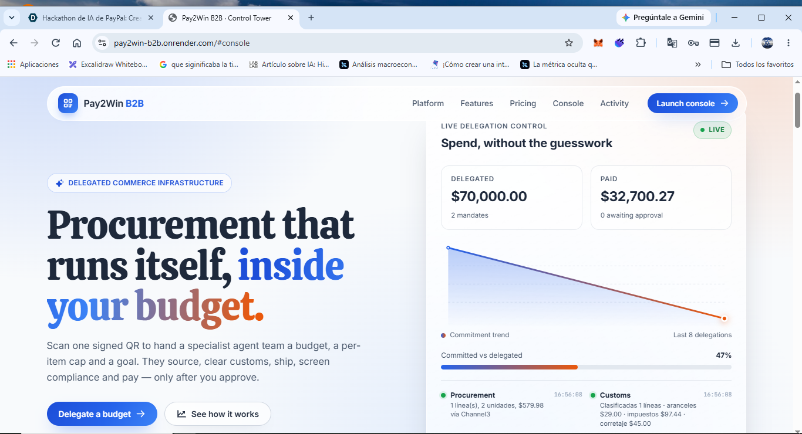
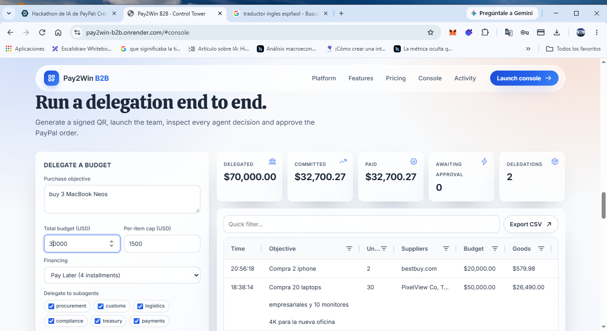
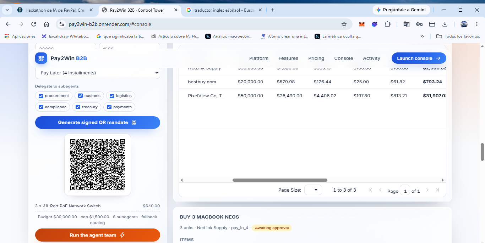
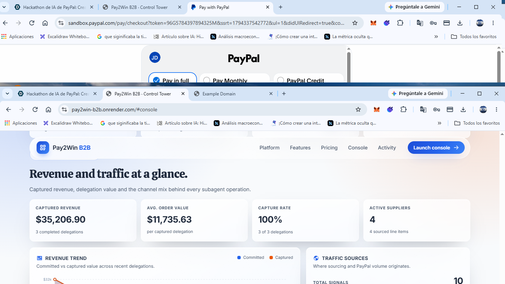
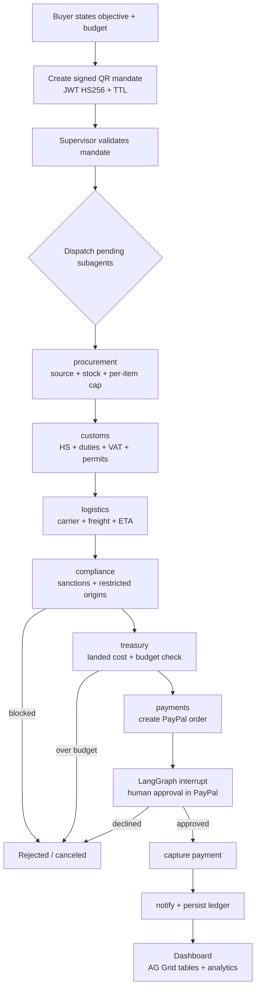

# Pay2Win B2B — Delegated Agentic Procurement

Pay2Win B2B is an agentic procurement platform. A buyer signs a single **QR mandate** that delegates a budget, a per-item spending cap and an objective to a supervisor agent. The supervisor dispatches a team of specialised subagents that source products, calculate landed cost, screen compliance, authorise the spend and prepare a PayPal payment. **Money only moves after a human approves the PayPal order.**

- Backend: FastAPI + LangGraph + LangChain (Groq for intent extraction)
- Sourcing: Channel3 live product search with an offline wholesale catalog fallback
- Payments: PayPal Sandbox (PayPal Agent Toolkit for order creation + REST for capture)
- Frontend: React + Vite + AG Grid (community) + custom SVG analytics
- Deployment: Render blueprint (`render.yaml`)

**Live app:** https://pay2win-b2b.onrender.com

**Demo video:** https://youtu.be/jPZXvJbuz7U?feature=shared



---

## 1. The problem companies and users have today

B2B purchasing for small and mid-sized companies is still fragmented and manual:

### Operational
- Purchases are scattered across email, WhatsApp, spreadsheets and phone calls.
- Getting quotes from several suppliers takes days.
- Buyers do not know real stock or final price until after they order.
- Manual approval chains become bottlenecks and delay supplier payments.

### Financial
- The **true landed cost** appears too late: duties, import VAT, freight and payment fees show up after the budget was already approved.
- Decentralised spending has no clear limits; any team or employee can overspend.
- Payment reconciliation and capture are manual and error-prone.

### Compliance and risk
- Companies buy from sanctioned suppliers or restricted origins without noticing.
- Restricted goods requiring export permits are purchased without validation.
- The result is fines, blocked shipments and reputational damage.

### Governance
- There is no clear audit trail of who authorised what, for how much and why.
- Delegating payments forces teams to share cards or account credentials, which opens the door to fraud.
- Auditing and reporting purchases is slow and inconsistent.

### Technical
- Integrating sourcing, tax, logistics and payments requires many providers and APIs.
- Handling webhooks, order states and payment retries is fragile to build in-house.

**Bottom line:** every purchase costs **time, money and control**, while adding **compliance and fraud risk**.

---

## 2. What this project solves

Pay2Win B2B turns a delegated budget into a supervised, auditable procurement run:

- **Safe delegation of money** — the buyer signs a mandate with hard limits instead of sharing payment credentials.
- **Landed cost before paying** — goods, duties, import tax, freight, brokerage and payment fees are consolidated into one total before any payment is created.
- **Automatic compliance** — sanctioned suppliers, restricted origins and permit-required goods are blocked before purchase.
- **Hard spending guardrails** — budget, per-item cap and a platform delegation limit are enforced by the agents, not by trust.
- **Human in the loop** — the payment is never captured without explicit approval in PayPal.
- **Full traceability** — every decision from every subagent is recorded in an audit trail and surfaced in the dashboard.
- **Real sourcing** — live product discovery and stock awareness, with a deterministic fallback catalog for offline demos.

---

## 3. Processes it makes fast

| Process | Before | With Pay2Win B2B |
| --- | --- | --- |
| Sourcing and quoting | Days of emails and calls | Seconds: product, supplier, price and stock |
| Customs and landed cost | Manual estimates, surprises later | Duties, VAT, freight, brokerage and fees in one pass |
| Compliance screening | Manual review per purchase | Instant sanctions / restricted-origin checks |
| Budget approval | Email chains and spreadsheets | Signed mandate with hard limits, enforced automatically |
| Payment creation | Manual PayPal setup | Order created automatically, captured after approval |
| Reporting | Rebuilding spreadsheets | Persistent ledger + dashboard + analytics |

---

## 4. Payments: how money is handled

### Two modes
The payment mode is chosen in `b2b/config.py`:

```python
SIMULATE_PAYMENTS = not (PAYPAL_CLIENT_ID and PAYPAL_CLIENT_SECRET)
```

- **`paypal_sandbox`** — real PayPal REST calls against `https://api-m.sandbox.paypal.com`. No real money moves.
- **`simulated`** — if credentials are missing or a real order fails, the `payments` subagent generates a sandbox-looking order id (`SBX...`) and approval link so the flow stays demoable.

### Payment flow
1. **Treasury authorises the amount**
   `grand_total = goods + duties + taxes + shipping + brokerage ($45) + payment fee (2.9% of goods)`.
   If `grand_total > budget`, treasury rejects the run and **no payment is created**.
2. **Financing schedule (informational)**
   `pay_in_4` splits the total into 4 installments; otherwise 30% advance + 70% balance.
   The PayPal order is created for the full total — the schedule is a planning view, not multiple captures.
3. **Order creation**
   The `payments` subagent creates a PayPal order through the **PayPal Agent Toolkit** (via the existing ReAct agent) and extracts the order id and approval URL.
4. **Human approval**
   The LangGraph workflow **interrupts** before capture. In sandbox mode, `/api/b2b/approve/{tid}` requires PayPal to report the order as `APPROVED` or `COMPLETED`; otherwise it returns HTTP 409.
5. **Capture**
   On approval, `POST /v2/checkout/orders/{id}/capture` is called and the final status is verified with `GET /v2/checkout/orders/{id}`. In simulated mode the payment is simply marked `captured: true`.
6. **Notifications**
   PayPal webhooks at `/api/b2b/paypal/webhook` verify the transmission signature (when `PAYPAL_WEBHOOK_ID` is configured), persist the event, and optionally forward a Slack-compatible notification.

### Guardrails
- Maximum delegation: `$250,000` (`B2B_MAX_DELEGATION`)
- Mandate TTL: `900s` (`B2B_MANDATE_TTL`)
- Per-item cap enforced during sourcing
- Budget check enforced by treasury
- Compliance can block the entire delegation

---

## 5. How the agent and subagents solve the problem

A **supervisor** owns the plan and dispatches **one specialised subagent at a time**. Each subagent only sees the shared state plus the mandate guardrails, and appends an audit entry to the trace.

| Subagent | Responsibility | Can block? |
| --- | --- | --- |
| `procurement` | Turns the objective into stock-checked items with price, supplier, origin and HS code. Enforces the per-item cap and adjusts quantity to stock. | Yes (no match / no stock) |
| `customs` | HS classification, duties, import VAT, brokerage, permits and DDP incoterm. | No |
| `logistics` | Weight, carrier/mode (courier, air, ocean), shipping cost, ETA and multi-supplier consolidation discount. | No |
| `compliance` | Sanctions screening, restricted suppliers/origins and export-permit flags. Computes a risk score. | **Yes** |
| `treasury` | Consolidates landed cost, checks the budget, builds the payment schedule and selects the payment mode. | **Yes** (over budget) |
| `payments` | Creates the PayPal order, returns the approval URL, and captures after human approval. | Yes (capture errors) |

### How the tools act
- **LangGraph `StateGraph`** defines the workflow and the human-approval interrupt. A checkpointer (Postgres in production, SQLite locally) persists each run by `thread_id`.
- **LangChain + Groq** (`ChatGroq` with structured output) extracts purchase intent from free-text chat: objective, items, quantities, budget, per-item cap and financing. A regex heuristic is used when no Groq key is configured.
- **Channel3Provider** posts to Channel3 search for live products and stock, normalises offers, and augments them with B2B trade attributes (HS code, duty rate, weight, origin). It falls back to a deterministic local catalog when the API key is missing or the call fails.
- **PayPal Agent Toolkit** creates the checkout order through the ReAct agent used by the consumer flow.
- **PayPal REST client** handles token caching, order status and capture deterministically.
- **Ledger** persists every delegation, its subagent trace, PayPal events and aggregate fields for the dashboard.
- **Webhooks** verify signatures, store events and optionally notify an external channel.

---

## 6. Project details

### Repository layout
```
b2b/
  api.py                 FastAPI app, routes and intent extraction
  team.py                Supervisor + LangGraph workflow
  mandate.py             HS256 JWT mandate + QR generation
  config.py              Environment and guardrails
  channel3.py            Channel3 provider + offline catalog
  paypal_client.py       PayPal REST client (token, status, capture)
  webhooks.py            PayPal webhook verification and handling
  ledger.py              Persistent delegation ledger and audit trail
  db.py                  Postgres/SQLite abstraction
  checkpointer.py        LangGraph checkpointer selection
  subagents/             procurement, customs, logistics, compliance, treasury, payments
  dashboard/             React + Vite + AG Grid frontend
  requirements.txt       B2B module dependencies
```

### API endpoints
| Method | Path | Purpose |
| --- | --- | --- |
| `GET` | `/api/b2b/health` | Health + integration status |
| `GET` | `/api/b2b/catalog` | Local wholesale catalog snapshot |
| `GET` | `/api/b2b/qr` | Create a signed mandate + QR |
| `POST` | `/api/b2b/chat` | Extract intent and prepare a mandate |
| `POST` | `/api/b2b/start` | Run the agent team from a mandate token |
| `POST` | `/api/b2b/approve/{tid}` | Approve/reject and resume capture |
| `GET` | `/api/b2b/orders` | All delegations for the dashboard |
| `GET` | `/api/b2b/orders/{tid}` | One delegation |
| `POST` | `/api/b2b/paypal/webhook` | Receive PayPal events |
| `GET` | `/api/b2b/paypal/events` | Stored PayPal events |
| `GET` | `/api/b2b/paypal/order/{order_id}` | Live PayPal order status |

### Status lifecycle
`delegado → abastecimiento_ok → tesoreria_ok → esperando_aprobacion → aprobado → completado`
with terminal `rechazado`, `cancelado`, `error`, `error_captura`.

### Quickstart (Windows PowerShell)
```powershell
python -m venv venv
.\venv\Scripts\Activate.ps1
pip install -r requirements.txt -r b2b/requirements.txt
copy .env.example .env   # add PayPal sandbox credentials, Groq and Channel3 keys

uvicorn b2b.api:api --reload --port 8001
# Dashboard: http://localhost:8001/   Docs: http://localhost:8001/docs
```

Build the dashboard:
```powershell
cd b2b\dashboard
npm install
npm run build
```

### Environment variables
| Variable | Purpose |
| --- | --- |
| `PAYPAL_CLIENT_ID` / `PAYPAL_CLIENT_SECRET` | PayPal sandbox credentials |
| `PAYPAL_API_BASE` | PayPal API host (sandbox by default) |
| `PAYPAL_WEBHOOK_ID` | Enables webhook signature verification |
| `GROQ_API_KEY` / `GROQ_MODEL` | LLM intent extraction |
| `QR_SECRET` | HS256 signing secret for mandates |
| `DATABASE_URL` | Postgres; falls back to SQLite when absent |
| `CHANNEL3_API_KEY` / `CHANNEL3_MODE` | Live product search |
| `B2B_MAX_DELEGATION`, `B2B_MANDATE_TTL` | Guardrails |
| `B2B_NOTIFY_WEBHOOK_URL` | Optional Slack-compatible notifications |

---

## 7. Markets and companies that become more efficient

- **SMBs and mid-market companies** with recurring purchases of equipment, IT hardware, office supplies or packaging.
- **Distributed procurement teams** where regional offices or employees buy locally but finance needs central control.
- **Procurement-as-a-service and BPO providers** managing purchases for multiple clients.
- **E-commerce and retail operations** that restock inventory and need fast landed-cost estimates.
- **Importers and cross-border traders** sensitive to duties, VAT, restricted origins and permits.
- **Fintech / payment platforms** that want to embed delegated, policy-controlled B2B spending.
- **Marketplaces and B2B SaaS** that want a "buy with agents" flow without building sourcing, compliance and payments themselves.

Especially valuable where **many small purchases, tight budgets and compliance requirements** meet — the exact place where manual processes are slowest and riskiest.

---

## 8. Technology stack

| Layer | Technology | Role |
| --- | --- | --- |
| Payments (now) | **PayPal Sandbox** | Safe end-to-end testing with no real money |
| Order creation | **PayPal Agent Toolkit** | Creates checkout orders via the ReAct agent |
| Capture / status | **PayPal REST API** | Deterministic capture and order verification |
| Orchestration | **LangGraph** | State graph, supervisor routing, human-approval interrupt, checkpointing |
| LLM | **LangChain + Groq** | Structured intent extraction from chat |
| Sourcing | **Channel3** | Live product search and stock, with local catalog fallback |
| Backend | **FastAPI + Uvicorn** | REST API and dashboard hosting |
| Persistence | **Postgres / SQLite** | Ledger + LangGraph checkpoints |
| Frontend | **React + Vite** | Interactive console |
| Tables | **AG Grid (community)** | Delegations, PayPal operations and sourcing grids |
| Charts | Custom **SVG** | Revenue trend and traffic sources analytics |
| Deploy | **Render** | Two-service blueprint with health checks |

### Why each piece
- **LangGraph** keeps agent state and makes the human approval a first-class interrupt that survives restarts through a checkpointer.
- **LangChain + Groq** lets the buyer express intent in natural language instead of filling forms.
- **Channel3** provides real product availability; the local catalog guarantees the demo works offline.
- **PayPal** is the trust boundary: the buyer approves in PayPal, and the platform only captures what was authorised.
- **Render** deploys the API and dashboard as separate services with environment-based configuration.

---

## 9. What the frontend shows

The React dashboard is a single page with a marketing narrative that leads into a live console:

- **Hero + live delegation panel** — delegated vs paid totals, commitment trend sparkline, budget utilisation and a per-subagent activity feed.
- **Trust band** — PayPal sandbox, Channel3 catalog, signed QR, human in the loop, audit trail.
- **Platform pipeline** — visual flow from QR mandate to PayPal.
- **Feature grid** — what each subagent contributes.
- **Pricing** — Explore, Growth and Enterprise plans.
- **Delegation console**
  - Mandate form: objective, budget, per-item cap, financing and allowed subagents.
  - Signed QR preview with sourced items and "Run the agent team".
  - Chat-to-mandate with LLM intent extraction.
  - KPI cards: delegated, committed, paid, awaiting approval, delegations.
  - **AG Grid** delegation table with quick filter, CSV export, row selection and an approval button.
  - Detail panel: items, budget allocation, payment schedule, compliance flags, PayPal notifications, subagent audit trail and order approval link.
- **Live operations section**
  - KPI widgets: PayPal operations, captured amount, Channel3 live vs fallback, suppliers.
  - **Analytics Overview**: captured revenue, average order value, capture rate, active suppliers.
    - **Revenue Trend** chart: committed vs captured value across recent delegations.
    - **Traffic Sources** bar chart: Channel3 live, local catalog, PayPal operations and webhook events.
  - **AG Grid: PayPal sandbox operations** — order creation, capture and webhook events per subagent.
  - **AG Grid: Channel3 sourcing usage** — product discovery and stock per line item, with fallback flagged.

The dashboard polls `/api/b2b/orders` every few seconds, so agent progress and payment state update in place.

---

## 10. Frontend walkthrough — from mandate to captured payment

The screenshots below follow a single delegation from the landing page to the captured PayPal payment. The dashboard is a React + Vite single page served by the FastAPI app at `/`.

### 10.1 Landing and live delegation control


The hero states the promise — procurement that runs itself inside your budget — and the live panel already shows delegated vs paid totals, the commitment trend and the subagent activity feed. It reads the same ledger the console writes to, so the marketing view and the operational view never diverge.

### 10.2 Delegate a budget


The buyer sets the purchase objective, total budget, per-item cap, financing (Pay Later in 4 installments or pay in full) and which subagents may run. No payment credentials are entered here: the form only creates a signed mandate.

### 10.3 Signed QR mandate


"Generate signed QR mandate" returns an HS256 JWT wrapped in a QR code, plus a preview of the sourced items, the budget, the per-item cap and the delegated subagent scope. Scanning the QR is what hands the budget to the supervisor agent.

### 10.4 Run the agent team


"Run the agent team" executes the LangGraph pipeline: procurement → customs → logistics → compliance → treasury → payments. Every subagent appends an entry to the audit trail and the KPIs update in place: delegated, committed, paid and awaiting approval.

### 10.5 PayPal order created — waiting for human approval


Treasury authorises the landed cost, then the `payments` subagent creates the PayPal order through the **PayPal Agent Toolkit**. The workflow interrupts before capture: the dashboard shows the order id, amount, breakdown, payment mode and PayPal status. **No money moves yet.**

### 10.6 Buyer approves inside PayPal


"Open PayPal approval" sends the buyer to the PayPal sandbox to review and approve the order. The platform never sees the buyer's credentials; approval happens inside PayPal. Back in the dashboard, `/api/b2b/approve/{tid}` verifies the order is `APPROVED` or `COMPLETED` before resuming the graph.

### 10.7 Capture confirmed


After approval the backend calls `POST /v2/checkout/orders/{id}/capture` and confirms the final state with `GET /v2/checkout/orders/{id}`. The delegation moves to `completado`, the paid KPI increases and the PayPal webhook events are persisted for audit.

### 10.8 Live operations and analytics


The Live Operations section streams every PayPal sandbox action and every Channel3 lookup. The Revenue Trend chart compares committed vs captured value and the Traffic Sources chart breaks down Channel3 live, local catalog, PayPal operations and webhook events.

> **Payment guarantee for the demo:** if PayPal credentials are absent or a real order fails, the flow falls back to `simulated` mode and generates a sandbox-looking order id, so the full mandate → approval → capture narrative still runs offline.

---

## 11. Application workflow



### Linear pipeline

```
QR mandate
  -> supervisor (validate + plan)
  -> procurement   (source, stock, per-item cap)
  -> customs       (HS code, duties, import tax, permits)
  -> logistics     (carrier, freight, ETA, consolidation)
  -> compliance    (sanctions, restricted origins, permits)
  -> treasury      (landed cost, budget guardrail, schedule)
  -> payments      (create PayPal order + approval URL)
  -> [HUMAN APPROVAL IN PAYPAL]
  -> capture       (only the authorised amount)
  -> notify        (message + audit trail + ledger)
```

### Simplified request lifecycle

```
POST /api/b2b/start { token }
  -> run LangGraph team
  -> interrupt with { order_id, approve_url, amount, breakdown }
  -> ledger.upsert(...) with status "esperando_aprobacion"
  -> dashboard shows the approval button

POST /api/b2b/approve/{tid} { approved: true }
  -> verify PayPal order status (sandbox mode)
  -> resume graph -> capture
  -> ledger.upsert(...) with status "completado"
  -> webhook events appear in the dashboard
```

---

## 12. Security and limitations

- Mandates are **signed JWTs (HS256)** with an expiry and a scope of allowed subagents.
- The buyer never shares payment credentials; approval happens inside PayPal.
- Webhook signatures are verified when `PAYPAL_WEBHOOK_ID` is configured; without it events are accepted unverified **for demo only**.
- Current deployment target is **PayPal Sandbox**. Switching to production requires live PayPal credentials and a production webhook configuration.
- The local wholesale catalog is deterministic demo data, not a live supplier feed.
- Channel3 and Groq are optional; the system degrades gracefully to fallback catalog and heuristic intent parsing.

---

## 13. License

See the root `LICENSE` file.
